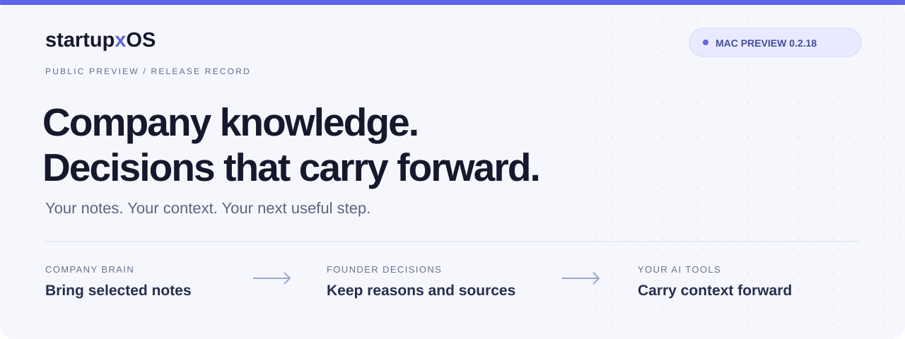
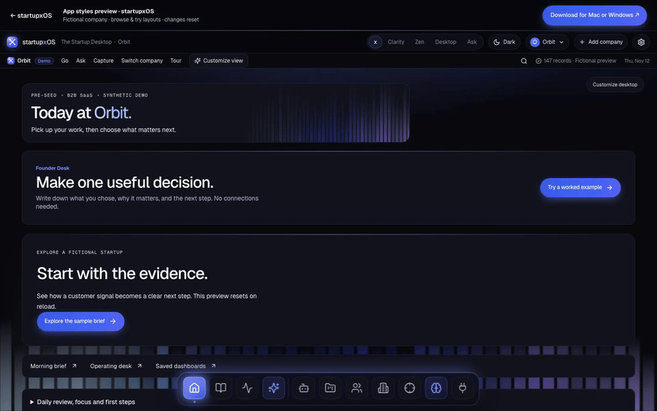

<p align="center">
  
</p>

<p align="center">
  <a href="https://www.startupxos.com/download"><strong>Get the Mac preview</strong></a> ·
  <a href="https://www.startupxos.com/alpha">Explore the guided demo</a> ·
  <a href="releases/v0.2.18.md">Latest release notes</a> ·
  <a href="https://github.com/megandmartin/startupxos/issues/new/choose">Report an issue</a>
</p>

**startupxOS brings your company knowledge, decisions and AI context into one workspace.** It is built for founders who already use AI and want their work to carry forward, with the original evidence close at hand.

This repository is the public home for **release notes, verified download checksums and feedback**. Application development happens in a private source repository; this is a product and release record, not an open-source distribution of the app.

## Start with one useful job

- **Bring the context you already have.** Preview a folder of Markdown or text notes, select the files to import, and keep the originals unchanged.
- **Keep decisions with their reasons.** Save a decision, its evidence and the next step so you can find them again after reopening the app.
- **Connect the AI tools you use.** Set up Claude Code or Codex from the app, and manage the access granted through the startupxOS connection.
- **Build a company brain over time.** Browse imported notes and their relationships, open original source wording, and use the context in your own company workspace.

The Mac workspace stores records locally in an encrypted vault. Optional external AI and connectors can receive the context you authorize; provider accounts, permissions and usage remain separate. See [current capabilities and limits](docs/STATUS.md).

<p align="center">
  <a href="https://www.startupxos.com/alpha"></a>
  <br><sub>Desktop preview tour. All company data shown is fictional; captured from an earlier preview.</sub>
</p>

## Choose the right preview

| Channel | Current status | Where to start |
|---|---|---|
| **Mac download** | **0.2.18** · Apple Silicon · macOS 15+ · Developer ID signed and notarized | [Download](https://www.startupxos.com/download) · [Install help](https://www.startupxos.com/install) |
| **Mac TestFlight** | Invitation-only testing; build availability can differ from the website download | Use the build shown in your TestFlight invitation |
| **Windows** | Coming soon; older Windows previews in release history are historical | [Current download status](https://www.startupxos.com/download) |
| **Guided web demo** | A scripted, fictional company example; no real company account or live agent execution | [Try the demo](https://www.startupxos.com/alpha) |

**Status checked 23 November 2026.** The desktop preview, TestFlight and browser demo are separate experiences. See [release channels](docs/STATUS.md) before comparing results across them.

## Latest public release: 0.2.18 for Mac

[Read the release notes](releases/v0.2.18.md) for the 20 November Mac preview:

- Guided setup for your company, AI connection and work source.
- Selected-file import for an existing second brain, with a preview before saving.
- A Terminal setup line for Claude Code and Codex in the TestFlight build.
- A Developer ID signed and notarized Mac download.

**Verify the download** against the version-specific [SHA-256 record](checksums/SHA256SUMS-0.2.18.txt). Installers are distributed through [startupxos.com/download](https://www.startupxos.com/download), not attached here.

```sh
shasum -a 256 ~/Downloads/startupxOS-0.2.18-20261120-arm64.dmg
```

Expected SHA-256:

```text
0fd060884e032e7b60461ba6f6cff2d1f89342255aa8bfdd44c5af14c44f7f49
```

## A visible development record

[CHANGELOG.md](CHANGELOG.md) separates public downloads, invitation-only test builds and the web demo. It records product changes, without presenting work under review as a shipped feature.

| Milestone | What it means |
|---|---|
| **23 Nov · Private Mac 0.2.19** | Selected imports with originals, local recap consent and agent icons; a signed and notarized test candidate. Public download remains 0.2.18 |
| **20 Nov · Mac 0.2.18** | Guided setup and own-note import reached the website download and TestFlight build 5 |
| **19 Nov · Guided web demo** | A fictional company walkthrough became available at `/alpha` |
| **Earlier previews** | Workspace encryption, saved decisions, desktop styles and guided tool setup evolved through the [release history](https://github.com/megandmartin/startupxos/releases) |

Releases remain early previews. Native installation, upgrades, recovery and provider connections need to be checked on the exact build and device you use. Passing a source test does not establish customer validation or every platform's readiness.

## Try it and help improve it

1. Download the Mac preview, or explore the fictional web demo first.
2. Start a test workspace with a small folder of non-sensitive notes.
3. Save one useful decision, quit and reopen, then check that the original context is easy to recover.
4. Tell us what worked and what got in the way. Include **version, build, channel and steps to reproduce** in a [bug report](https://github.com/megandmartin/startupxos/issues/new?template=bug_report.yml).

GitHub issues are public. Leave out company information, passwords, recovery keys, connection details and account tokens. Report security concerns through the [private security channel](SECURITY.md).

## Built by

[Megan Martinsone](https://github.com/megandmartin), co-founder leading product and engineering. [Matti](https://github.com/mattibouffier-source), co-founder leading customers, pilots, go-to-market and operations. startupxOS continues the company-memory work of [SuperBrain](https://github.com/megandmartin/superbrain-downloads).
