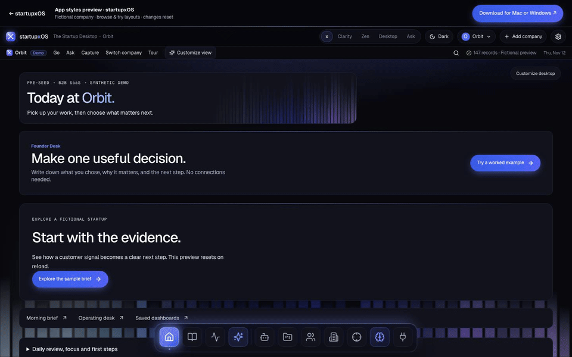

  

<h1 align="center">startupxOS</h1>

<strong>Your agents do the work. You run the company.</strong> The AI operating system for startups.

  <a href="https://www.startupxos.com/preview"><strong>Try the live preview</strong></a> ·
  <a href="https://www.startupxos.com/download">Download for Mac or Windows</a> ·
  <a href="#releases">Release notes</a> ·
  <a href="https://github.com/megandmartin/startupxos/issues/new/choose">Give feedback</a>

This is the public home for startupxOS **release notes, checksums and feedback**. The app's source is private.

## What it does

- **One company brain.** Capture company information with its source, and link decisions to their evidence and outcomes.
- **Agents draft, you approve.** Drafts pause in Approvals until you approve, edit or decline them. Nothing leaves without you.
- **Your AI tools, scoped.** Claude and Codex connect through MCP and see only what you grant, with an audit trail per tool.
- **Your data stays yours.** An encrypted workspace on your own computer, with a vault password and an optional recovery key.

The [web preview](https://www.startupxos.com/preview) runs a fictional demo company in your browser, with nothing to install.

## Download

| | Requirements | |
|---|---|---|
| **Mac** | Apple Silicon · macOS 15 or later | [Download](https://www.startupxos.com/download) |
| **Windows** | Intel or AMD x64 · Windows 11 | [Download](https://www.startupxos.com/download) |

Early preview: the Mac build is ad-hoc signed and not yet notarized, and the Windows installer is not yet publisher-signed, so your computer may warn before opening it. Read the [install notes](https://www.startupxos.com/install) and check the download against the published [SHA-256 checksums](https://www.startupxos.com/releases/SHA256SUMS.txt).

## Releases

| Version | Date | What changed |
|---|---|---|
| [**0.2.15**](https://github.com/megandmartin/startupxos/releases/tag/v0.2.15) · Mac and Windows | 12 Nov 2026 | The new startupxOS look: styles x, Clarity and Zen, in light and dark, kept through lock, restart and upgrade. Agent approvals never show more than the records they quote |
| [0.2.11](https://github.com/megandmartin/startupxos/releases/tag/v0.2.11) · Windows | 10 Nov 2026 | Resumable vault setup; clearer password and workspace errors; add a recovery key later in Settings |
| [0.2.9](https://github.com/megandmartin/startupxos/releases/tag/v0.2.9) · Mac | 4 Nov 2026 | Encrypted workspaces with vault passwords, recovery keys, and an encrypted database and backups |

This list shows the versions offered for public download. Each release page has the notes and SHA-256 checksums; installers are only on [startupxos.com/download](https://www.startupxos.com/download).

## Built by

[Megan Martinsone](https://github.com/megandmartin), co-founder, CEO and CTO, who writes the code: Electron, React, Node.js, an encrypted SQLite workspace and MCP. startupxOS is built on the [SuperBrain](https://github.com/megandmartin/superbrain-downloads) company-memory core.

Open-source components and their licences: [startupxos.com/open-source](https://www.startupxos.com/open-source).
